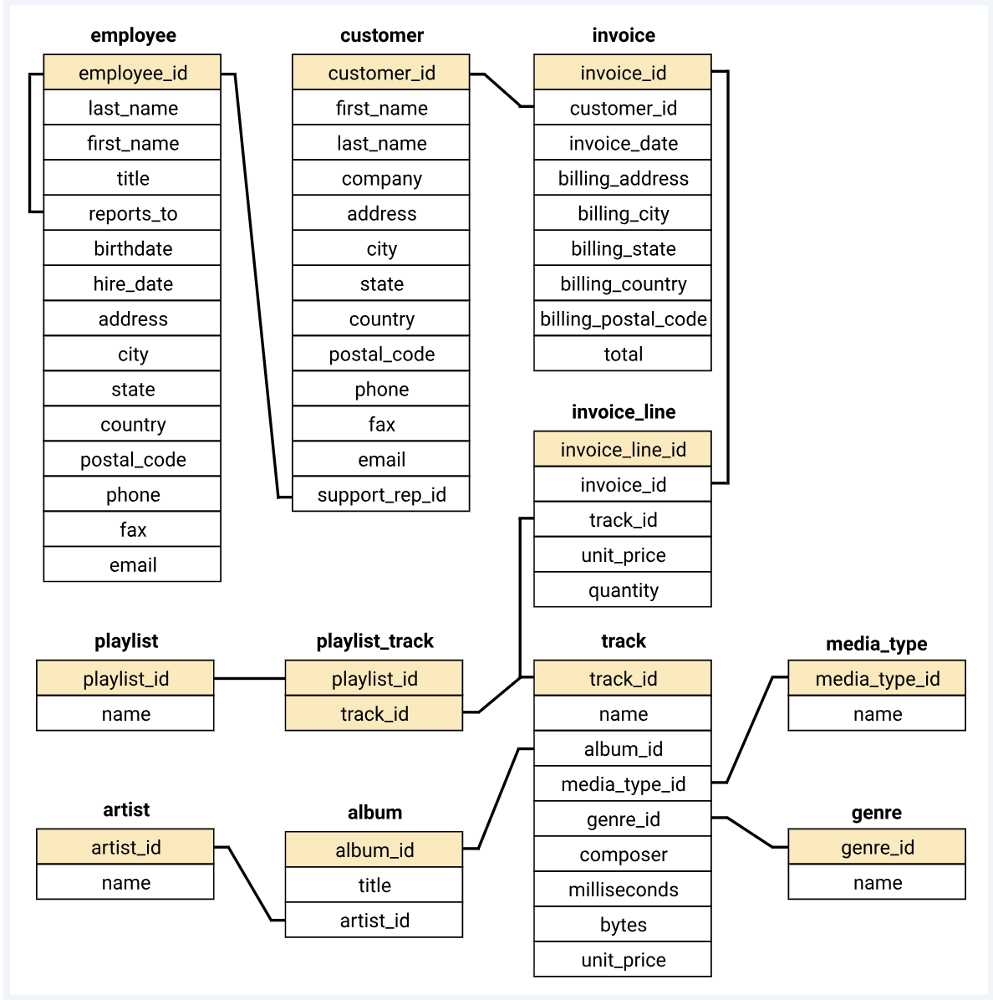

# Music_store_Data-Analysis

# 🎵 Music Store Data Analysis – SQL Project

## 📌 Project Overview

The **Music Store Data Analysis Project** is a SQL-based data analysis project using a relational music store database. The main objective is to analyze customer purchases, music genres, artists, invoices, and sales performance to generate meaningful business insights.

This project uses **PostgreSQL** to explore the database and solve business-related questions using SQL queries, joins, aggregations, subqueries, CTEs, and window functions.

## 🎯 Project Objectives

- Identify the top-performing customers.
- Analyze invoice distribution across different countries.
- Identify the highest-revenue cities.
- Find customers who listen to Rock music.
- Identify the top 10 Rock music artists.
- Analyze music genres and customer purchasing patterns.
- Identify the most popular music genre in each country.
- Analyze customer spending across different countries.
- Understand artist sales performance.

## 🗄️ Database Information

The project uses a Music Store relational database containing the following tables:

| Table Name | Description |
|---|---|
| `artist` | Artist information |
| `album` | Album details |
| `customer` | Customer information |
| `employee` | Employee details |
| `genre` | Music genre information |
| `track` | Music track details |
| `invoice` | Customer invoice records |
| `invoice_line` | Invoice purchase details |
| `media_type` | Media type information |
| `playlist` | Playlist information |
| `playlist_track` | Playlist and track relationships |

## 🛠️ Tools & Technologies

- **PostgreSQL** – Database management and SQL queries
- **pgAdmin 4** – Database administration and query execution
- **SQL** – Data analysis and business insights
- **GitHub** – Project documentation and version control

## 📚 SQL Concepts Used

This project covers three levels of SQL analysis.

### 1. Easy Level

1. Find the senior-most employee based on job title.
2. Identify the countries with the most invoices.
3. Find the highest invoice values.
4. Identify the city generating the highest revenue.
5. Find the customer who has spent the most money.

**SQL Concepts:**
- SELECT
- ORDER BY
- GROUP BY
- COUNT()
- SUM()
- LIMIT
- INNER JOIN

### 2. Moderate Level

1. Identify customers who listen to Rock music.
2. Find the top 10 artists who have created the most Rock tracks.
3. Find tracks longer than the average song length.

**SQL Concepts:**
- DISTINCT
- Multiple JOINs
- Subqueries
- Aggregate Functions
- AVG()
- Filtering with WHERE
- Sorting with ORDER BY

### 3. Advanced Level

1. Analyze customer spending on the best-selling artist.
2. Identify the most popular music genre in each country.
3. Find the highest-spending customer in each country.

**SQL Concepts:**
- Common Table Expressions (CTEs)
- WITH Clause
- Recursive CTEs
- Window Functions
- ROW_NUMBER()
- PARTITION BY
- Multiple Table JOINs
- MAX()
- SUM()

## 📊 Key Business Questions

The project focuses on answering important business questions:

- Which country generates the most invoices?
- Which city generates the highest total revenue?
- Who is the best customer?
- Which artists produce the most Rock tracks?
- Which music genre is most popular in different countries?
- Which customers spend the most on music?
- Which tracks are longer than the average track duration?

## 📁 Project Structure

```text
Music-Store-Analysis-SQL/
│
├── Music_Store_Query.sql
│
├── music_store_schema.sql
│
├── Music_Store_database.backup
│
├── Music_Store_Analysis_Questions.pdf
│
└── Raw-music-store-analysis/
    └── music store data/
        ├── album.csv
        ├── album2.csv
        ├── artist.csv
        ├── customer.csv
        ├── employee.csv
        ├── genre.csv
        ├── invoice.csv
        ├── invoice_line.csv
        ├── media_type.csv
        ├── playlist.csv
        ├── playlist_track.csv
        ├── track.csv
        └── schema_diagram.png
```

*Note: The structure above describes the main project resources. File names in your GitHub repository can differ.*

## ⚙️ How to Run This Project

**Step 1:** Install PostgreSQL and pgAdmin 4.

**Step 2:** Create a database named `music_database`.

**Step 3:** Import the Music Store database backup or load the CSV datasets into the corresponding tables.

**Step 4:** Open pgAdmin 4 and connect to your database.

**Step 5:** Open the SQL query file.

**Step 6:** Execute the SQL queries to explore the database and analyze the results.

## 💡 Skills Demonstrated

- SQL Query Writing
- Relational Database Management
- Data Analysis
- Data Aggregation
- Data Filtering
- Customer Segmentation
- Sales Analysis
- Business Problem Solving
- PostgreSQL Database Handling

## 📈 Project Outcome

Through this project, I practiced solving real-world business problems using SQL and learned how to extract meaningful information from relational databases.

The project helped me strengthen my understanding of SQL fundamentals, advanced queries, data relationships, and analytical thinking.

## 👨‍💻 Author

**MD Subhan Khan**
